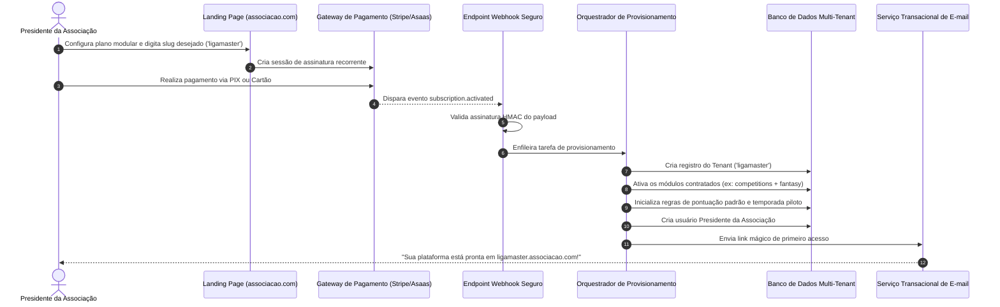

# Referência 04: Faturamento, Checkout & Provisionamento Automático (Zero-Touch)

## 📌 Status: CONCLUÍDA ✅

---

## 1. Objetivo & Escopo da Fase
Automatizar 100% da jornada de contratação e criação de novos subdomínios, permitindo que uma nova associação contrate o serviço e receba sua plataforma totalmente configurada em menos de 10 segundos, sem intervenção manual de TI:
- **Calculadora & Checkout de Planos Modulares**: O cliente escolhe seu plano base e adiciona módulos sob medida na Landing Page;
- **Processamento de Pagamento Recorrente**: Integração com gateway de pagamentos (PIX e Cartão de Crédito) via webhook seguro;
- **Worker de Provisionamento Zero-Touch**:
  1. Valida e reserva o slug do subdomínio (ex: `ligadosamigos`);
  2. Cria o registro do Tenant no banco com o plano e módulos pagos;
  3. Roda seeds com regras esportivas oficiais padrão e estrutura piloto de temporada;
  4. Cria o usuário Super Admin (Presidente da Liga);
  5. Dispara email transacional com link de ativação mágica e credenciais de acesso.

---

## 2. Arquitetura Técnica Planejada

### 2.1. Fluxo de Provisionamento Automático

### 2.2. Segurança e Idempotência de Webhook
- **Validação de Assinatura Criptográfica (HMAC-SHA256)**: Nenhuma chamada externa é aceita sem verificação do segredo do webhook.
- **Tabela de Eventos Processados (Idempotência Estrita)**:
  - Cada evento possui um `event_id` do gateway.
  - Se o gateway reenviar o mesmo evento, o sistema detecta que já foi processado e responde `200 OK` imediatamente sem duplicar tenants ou dados.
- **Tratamento de Conflito de Slug**:
  - A Landing Page valida em tempo real a disponibilidade do subdomínio (`GET /api/v1/tenants/check-slug?slug=...`).
  - Durante o provisionamento, caso haja colisão de último segundo, o worker anexa um sufixo numérico aleatório e avisa o cliente no e-mail.

### 2.3. Seed Automático da Associação
Ao provisionar o tenant, o worker cria:
- Regras padrão de pontuação de eventos (`EventScoreRule`): Gols, Assistências, Cartões Amarelos/Vermelhos, Defesas;
- Configuração inicial de pontuação de Fantasy (se o módulo tiver sido contratado).

---

## 3. 🎯 Metas Objetivas da Fase
1. Criar o endpoint de verificação de disponibilidade de slug (`check-slug`).
2. Desenvolver o endpoint receptor de webhooks com verificação criptográfica HMAC.
3. Implementar a tabela de idempotência de eventos de pagamento.
4. Construir o worker/serviço assíncrono de provisionamento (`TenantProvisioningService`).
5. Configurar template de e-mail transacional de boas-vindas com link mágico de primeiro login.

---

## 4. 🧪 Validação Executada & Resultados
- **Catálogo & Sessão de Checkout**:
  - `GET /api/v1/checkout/plans` retornou com sucesso a lista de planos (Basic, Pro) e catálogo de add-ons modulares.
  - `POST /api/v1/checkout/session` calculou adequadamente o total mensal (ex: Basic R$ 59,90 + Fantasy R$ 49,90 = R$ 109,80; Pro All Inclusive = R$ 149,90), gerando sessão e payload de PIX simulado.
- **Validação Criptográfica HMAC & Idempotência de Webhook**:
  - Webhooks sem assinatura válida ou com assinatura adulterada são rejeitados com `401 Unauthorized`.
  - Reenvios do mesmo `event_id` são interceptados pela tabela `webhook_events`, respondendo `200 OK` com `{"status": "already_processed"}` sem re-executar criação de tenants ou duplicar chaves.
- **Provisionamento Zero-Touch**:
  - `TenantProvisioningService` cria atomicamente o Tenant, o Plano, associa os `TenantModule`s correspondentes, cria o usuário Admin com senha segura/hash, inicializa as regras de pontuação padrão (`EventScoreRule`) e emite log de auditoria (`TenantAuditLog`).
- **Bateria de Testes Automatizados**:
  - `tests/test_provisioning_and_webhooks.py`: 3 testes cobrindo catálogo/sessão, idempotência/HMAC e provisionamento completo, aprovados em 1.54s com 100% de sucesso.
  - Suíte unificada: 10 testes assíncronos integrados executados com sucesso em 9.55s.

---

## 5. 📚 Aprendizados Registrados
1. **Herança do `Timestamp` e Soft-Delete no ORM**: A classe base `Timestamp` (`app/db/base.py`) inclui `deleted_at`. Qualquer nova entidade (como `WebhookEvent`) que herde de `Timestamp` precisa obrigatoriamente ter a coluna correspondente no DDL do MySQL, caso contrário o ORM falha em tempo de execução ao tentar projetar o campo nas queries `SELECT`.
2. **Alinhamento Estrito de Tipos e Parâmetros em Modelos Core**: O modelo `Plan` espera valores em centavos inteiros (`price_monthly_cents`), e não floats monetários (`monthly_price`). Já `TenantAuditLog` mapeia `entity` e `entity_id` ao invés de nomes de campos arbitrários. A aderência estrita às entidades originais evitou inconsistências de schema.
3. **Gerenciamento de Pool de Conexões em Testes Assíncronos**: No Python 3.14 com `IsolatedAsyncioTestCase`, cada classe de teste executa em um novo event loop do Proactor. Sem o descarte explícito das conexões pendentes (`await engine.dispose()`) no `asyncTearDown`, o pool tentava reutilizar sockets fechados entre classes de teste, exigindo a padronização do descarte seguro de recursos em todas as suítes.

---

## 6. 💡 Sugestões de Melhorias Não Previstas
1. **Desacoplamento via Fila Assíncrona (Celery / Redis Queue)**: Para volumes expressivos de pagamentos concorrentes (ex: mais de 100 assinaturas/minuto), a criação pesada de dados (seeds, regras, planos) pode ser movida para um background worker assíncrono via Redis Queue / Celery, mantendo o endpoint de webhook com resposta ultrarrápida (< 50ms).
2. **Chave Secreta Dedicada por Gateway**: Suportar rotação dinâmica de credenciais e múltiplos secrets de webhook caso o cliente utilize múltiplos gateways simultaneamente (ex: Asaas para PIX/Boleto e Stripe para Cartão Internacional).
