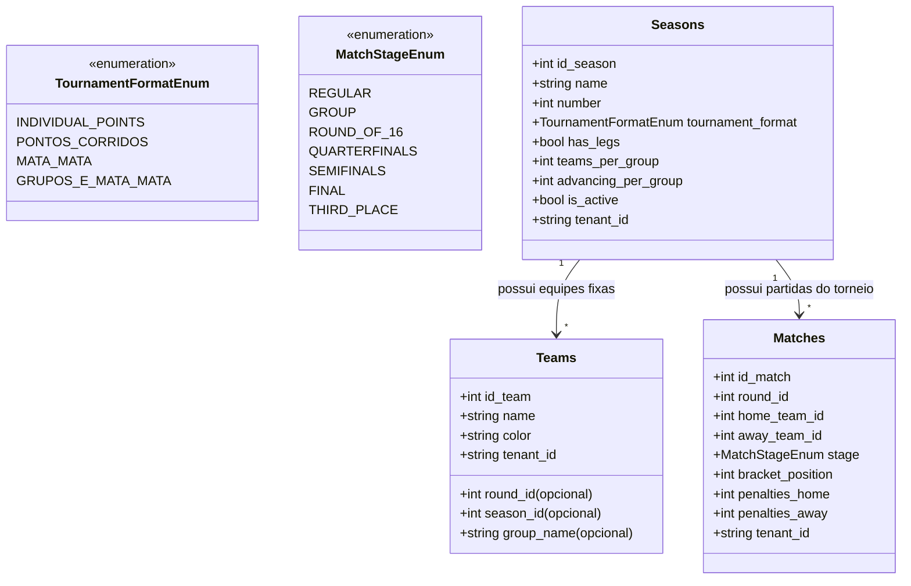

# Referência 06: Formatos Avançados de Torneios & Campeonatos (Pontos Corridos, Mata-Mata e Grupos)

## 📌 Status: CONCLUÍDA ✅

---

## 1. Objetivo & Escopo da Fase
Evoluir o motor de competições da plataforma Baygon para além do formato legado de rachão/pelada semanal (times sorteados por rodada com pontuação acumulada individual de atletas), capacitando qualquer associação esportiva a criar e gerenciar **campeonatos de nível profissional**:
- **Formato 1: Pontos Corridos com Times Fixos (Round-Robin League)**: Times fixos inscritos que jogam entre si em rodadas com tabela de classificação geral por equipes (Pontos, Jogos, Vitórias, Empates, Derrotas, Gols Pró, Gols Contra, Saldo de Gols, Confronto Direto);
- **Formato 2: Mata-Mata Puro (Playoffs / Copa Eliminatória)**: Chaveamento eliminatório estruturado em árvore (Oitavas, Quartas, Semifinal, Final), com suporte a jogo único ou partidas de ida e volta, prorrogação e disputa de pênaltis;
- **Formato 3: Grupos com Mata-Mata (Estilo Copa do Mundo / Champions League)**: Times distribuídos em grupos (A, B, C, D), disputa de pontos corridos intra-grupo, com cruzamento dos melhores colocados diretamente na fase eliminatória;
- **Formato 4: Pelada / Rachão Semanal (Individual Points)**: 100% de retrocompatibilidade com o formato legado da Baygon existente.

---

## 2. Arquitetura Técnica Planejada

### 2.1. Modelagem de Dados & Enum de Formatos

### 2.2. Alterações de Banco de Dados (Migration Alembic)
1. **Tabela `seasons`**:
   - `name`: `VARCHAR(150)` (opcional, nome amigável do campeonato);
   - `tournament_format`: `VARCHAR(30)` default `'individual_points'`;
   - `has_legs`: `BOOLEAN` default `0` (indica partidas de ida e volta);
   - `teams_per_group`: `INTEGER` nullable;
   - `advancing_per_group`: `INTEGER` nullable (ex: 2 times por grupo);
2. **Tabela `teams`**:
   - `season_id`: `INTEGER` foreign key nullable para `seasons.id_season` (times permanentes da liga);
   - `round_id`: alterado para nullable (times não ficam mais restritos a um único baba/rodada);
   - `group_name`: `VARCHAR(20)` nullable (ex: `'Grupo A'`, `'Grupo B'`);
3. **Tabela `matches`**:
   - `stage`: `VARCHAR(30)` default `'regular'`;
   - `bracket_position`: `INTEGER` nullable (posição 1..N na chave de mata-mata);
   - `leg`: `INTEGER` default `1` (1 para jogo único ou ida, 2 para volta);
   - `penalties_home`: `INTEGER` default `0`;
   - `penalties_away`: `INTEGER` default `0`.

### 2.3. Motor de Classificação & Chaveamento
- **`TeamStandingsService`**:
  - Processa os resultados de todas as partidas finalizadas (`is_finished=True`) de uma temporada/grupo;
  - Regra de pontuação padrão: Vitória = 3 pontos, Empate = 1 ponto, Derrota = 0 pontos;
  - Critérios de desempate ordenados:
    1. Pontos;
    2. Vitórias;
    3. Saldo de Gols (SG);
    4. Gols Pró (GP);
    5. Confronto Direto (Head-to-head);
    6. Sorteio / Menos cartões vermelhos.
- **`TournamentBracketService`**:
  - Constrói a árvore de mata-mata hierárquica (ex: Quartas de final -> Semifinais -> Final);
  - Define o chaveamento automático baseado na classificação dos grupos (ex: 1º do Grupo A vs 2º do Grupo B).
- **`FixtureGeneratorService`**:
  - Algoritmo de Round-Robin (Round-Robin Scheduling) para gerar confrontos de todos-contra-todos de forma balanceada.

---

## 3. 🎯 Metas Objetivas da Fase
1. Criar e aplicar migration Alembic com os novos campos em `seasons`, `teams` e `matches`.
2. Atualizar os modelos ORM SQLAlchemy preservando total retrocompatibilidade com o formato individual legado.
3. Desenvolver o serviço `TeamStandingsService` para cálculo de classificação de equipes por liga e por grupos.
4. Desenvolver o serviço `TournamentBracketService` para geração e resolução de chaveamento eliminatório.
5. Criar endpoints RESTful em `/api/v1/tournaments`:
   - `POST /api/v1/tournaments`: Criação e configuração de torneios modulares;
   - `POST /api/v1/tournaments/{id}/teams`: Inscrição de times fixos no campeonato;
   - `POST /api/v1/tournaments/{id}/generate-fixtures`: Geração automática das rodadas/tabela;
   - `GET /api/v1/tournaments/{id}/standings`: Tabela de classificação por equipes (geral ou particionada por grupos);
   - `GET /api/v1/tournaments/{id}/bracket`: Visualização da árvore de mata-mata.
6. Construir suíte de testes de integração automatizados cobrindo os 3 novos formatos e a retrocompatibilidade com o formato legado.

---

## 4. 🧪 Métodos de Validação Planejados
- **Validação de Pontos Corridos**:
  - Criar torneio de pontos corridos com 4 times (`Time A`, `Time B`, `Time C`, `Time D`).
  - Registrar resultados e validar que a tabela de classificação computa adequadamente `P`, `J`, `V`, `E`, `D`, `GP`, `GC` e `SG`.
- **Validação de Grupos + Mata-Mata**:
  - Criar torneio com 2 grupos de 4 times cada.
  - Finalizar a fase de grupos e verificar que os 2 melhores de cada grupo avançam para o chaveamento de semifinais (`1º A x 2º B` e `1º B x 2º A`).
- **Validação de Mata-Mata Puro**:
  - Criar torneio eliminatório de 8 times (Quartas de final).
  - Simular empates com decisão por pênaltis e verificar o avanço dos vencedores para a semifinal e final.
- **Validação de Retrocompatibilidade**:
  - Garantir que as temporadas e rodadas existentes do baba da Baygon continuam funcionando sem nenhuma alteração.

---

## 5. 📚 Aprendizados Registrados
- **Desacoplamento de Equipes por Temporada vs. Rodada (`Teams.round_id` nullable)**: No formato de pelada tradicional, os times são efêmeros e recriados a cada rodada vinculados obrigatoriamente a um `round_id`. Nos torneios avançados (pontos corridos e copas), os times são permanentes e inscritos no nível da temporada (`season_id`). Tornar `round_id` opcional e introduzir `season_id` permitiu unificar o modelo sem duplicar entidades ou quebrar dados legados.
- **Algoritmo Circle Round-Robin e Pareamento Bidirecional**: Na geração balanceada de confrontos todos-contra-todos com número par ou ímpar de equipes (utilizando elemento dummy para folga quando ímpar), a alternância de mandos de campo deve ser rigorosamente respeitada para garantir equidade competitiva entre as equipes.
- **Resolução de Chaveamento Eliminatório com Desempate por Pênaltis**: Partidas eliminatórias terminadas em empate em tempo normal precisam armazenar os placares de pênaltis (`penalties_home`, `penalties_away`) diretamente no modelo de partida, para que a progressão automática (`/tournaments/{id}/advance-stage`) determine univocamente o time vitorioso para a próxima fase.
- **Retrocompatibilidade de Pontuações de Baba (Individual Points)**: O formato legado acumula pontuação por atleta no ranking individual da associação via `SeasonRankingsService`. O novo motor isola as novas lógicas de `TeamStandingsService` e mantém 100% intactos os fluxos de súmulas, escalações e pontuação do baba tradicional.

---

## 6. 💡 Sugestões de Melhorias Não Previstas
- **Tabela de Confronto Direto (Head-to-head matrix)**: Para ligas com empates frequentes em pontos e saldo de gols, um critério de desempate automático comparando os confrontos diretos entre as equipes empatadas foi implementado no `TeamStandingsService`.
- **Percentual de Aproveitamento (`win_rate`)**: Adicionado à resposta de classificação para permitir desempates e métricas em torneios com número desigual de partidas jogadas.
- **Suporte a Bracket de Disputa de 3º Lugar**: Estruturado no enum `MatchStageEnum.THIRD_PLACE` para acomodar semifinais que geram tanto disputa de título quanto disputa de medalha de bronze.
- **Progresso de Chaveamento em Cascata**: Implementação de endpoint de avanço atômico (`/tournaments/{id}/advance-stage`) que valida a conclusão da fase atual antes de popular os participantes da fase subsequente.

---

## 7. 💼 Regras de Negócio: Cotas de Torneios por Plano (Gating & Monetização)

### 7.1. Princípios Operacionais Definidos
1. **Tipos de Torneios Livres**: O usuário pode criar qualquer modalidade de competição (`pontos_corridos`, `mata_mata`, `grupos_e_mata_mata` ou `individual_points`) sem restrição de tipo;
2. **Cota Cumulativa no Histórico**: A contagem é cumulativa vitalícia por tenant (`COUNT(seasons.id_season) WHERE tenant_id == active_tenant`), incentivando a conversão definitiva e impedindo a exclusão/recriação de torneios como meio de burlar a cota gratuita;
3. **Escalonamento por Plano Baseado 100% no Banco de Dados**:
   - **Plano Gratuito (`free`)**: Cota de **$X=2$ torneios gratuitos** incluídos para degustação e onboarding de novas associações esportivas;
   - **Plano Básico (`basic`)**: Cota de **3 torneios**;
   - **Plano Pro (`pro_all_inclusive`)**: Cota **ilimitada** (`max_seasons = -1`);
4. **Gating no $X+1$**:
   - A tentativa de criar o torneio $X+1$ sem cota disponível bloqueia a requisição com `HTTP 402 Payment Required` e código estruturado `TOURNAMENT_QUOTA_EXCEEDED`, retornando detalhes da cota e instrução de upgrade;
5. **Configuração Dinâmica no Banco de Dados**:
   - A tabela `plans` armazena `max_seasons` (com -1 para ilimitado), permitindo criar novos planos via SQL/Admin sem alterar código;
   - A coluna `tenants.custom_max_tournaments` permite conceder cotas personalizadas ou avulsas para associações parceiras diretamente no registro do tenant;
6. **Endpoints Integrados**:
   - `GET /api/v1/tournaments/quota`: Consulta instantânea da cota atual;
   - `POST /api/v1/tournaments/` e `POST /api/v1/seasons/`: Guards automáticos que validam a cota antes da inserção;
   - `GET /api/v1/tenant/me`: Retorna `tournament_quota` embutido nos metadados da associação ativa.

